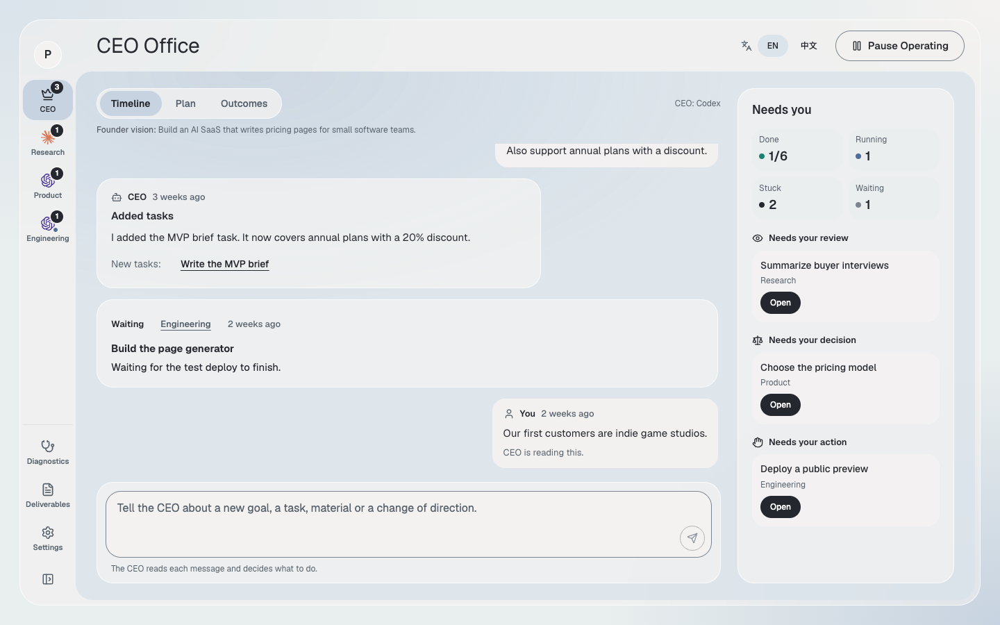
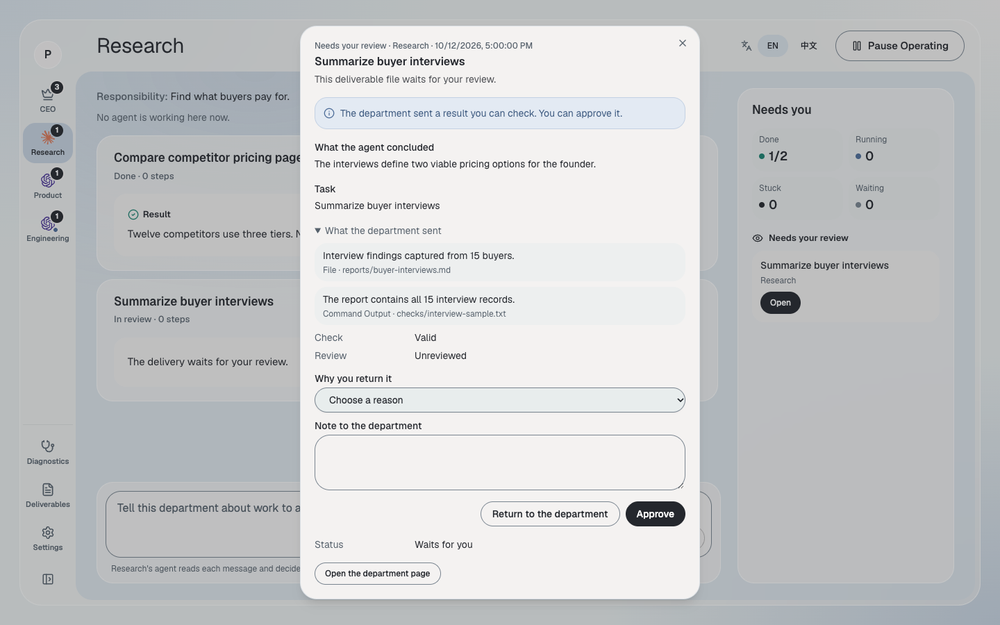
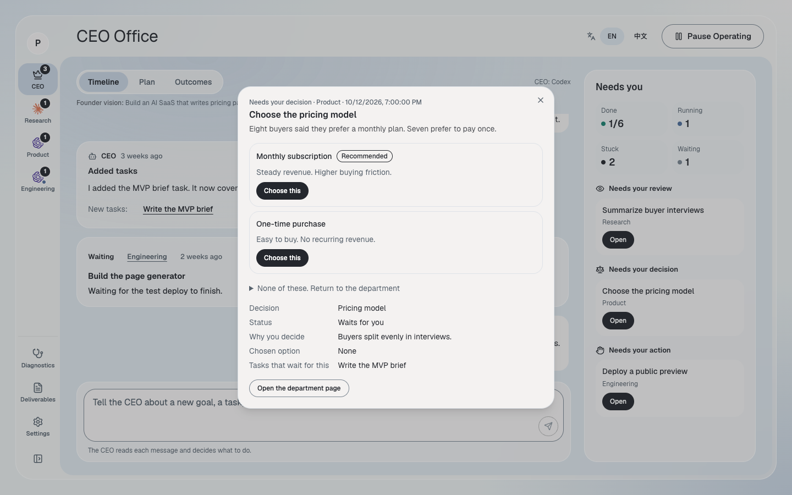

# Cordantry

Cordantry is an open-source runtime for local AI agents.

You give Cordantry a company goal. A local agent acts as the CEO. The CEO creates goals, departments, tasks, and handoffs. Other agents do the work. Cordantry checks the results and asks for your decision when human judgment is required.

Cordantry runs on your computer. It works inside a project that you select.

- [Website](https://xiaolinggmm.github.io/cordantry/)
- [Desktop app](https://github.com/xiaolinggmm/cordantry/releases/latest)
- [Source code](https://github.com/xiaolinggmm/cordantry)



## How It Works

1. Name the company and state its goal.
2. Select Claude Code or Codex as the CEO agent.
3. The CEO creates a company plan.
4. Cordantry assigns work to agents.
5. Each agent submits a result and evidence.
6. Cordantry checks the work and its dependencies.
7. You review important decisions and outcomes.

Cordantry stores the plan, work, evidence, and review history. You can add direction, pause the company, or stop it at any time.



Cordantry returns strategic choices to you. It shows the available options, tradeoffs, and affected work.



## Install the Desktop App

Use the desktop app for normal use.

1. Download the [latest release](https://github.com/xiaolinggmm/cordantry/releases/latest).
2. Install Claude Code or Codex.
3. Sign in to the installed agent.
4. Start Cordantry.
5. Select the local project that Cordantry may use.

The desktop app includes the runtime and dashboard. It does not include Claude Code or Codex.

## Configure a Company

The setup form asks for four main values.

### Company name

Enter a name that identifies the company.

### CEO agent

Select a detected Claude Code or Codex installation. The CEO agent creates the plan and assesses later direction.

### Founder vision

State the result that you want. Include the target user, the required outcome, and important limits.

Example:

> Build a local web tool for freelance designers. The tool must turn a project brief into a client proposal. Deliver a working prototype and a validation report. Do not publish the tool or use paid services without my approval.

### Execution mode

Select the mode when you create the company. You cannot change it later.

- **Direct dispatch** starts the assigned local agent. This is the default mode.
- **MAH coordination** delegates each task to an existing MAH project.

MAH coordination requires the MAH project path. It also requires the `mah` executable. The default execution slot is `background`.

The current dashboard uses `balanced` permission mode. This mode allows normal work inside the task workspace. High-impact actions still require approval or remain blocked.

## Run From Source

Requirements:

- Node.js 24 or newer
- pnpm 11 or newer
- Git
- Claude Code or Codex for real agent runs

Install the project:

```bash
git clone https://github.com/xiaolinggmm/cordantry.git
cd cordantry
pnpm install
```

Run the checks:

```bash
pnpm test
pnpm typecheck
```

Start Cordantry for a local project:

```bash
INIT_CWD=/absolute/path/to/your/project \
CORDANTRY_PORT=8787 \
pnpm --filter @cordantry/cli start
```

Start the dashboard in another terminal:

```bash
VITE_CORDANTRY_API_URL=http://127.0.0.1:8787 \
pnpm --filter @cordantry/dashboard dev
```

Open the URL that Vite prints. The default URL is `http://127.0.0.1:5173/`.

## Local Data

Cordantry writes state and work files inside the selected project:

```text
.cordantry/
  state.sqlite
  supervisor.sqlite
  companies/
  workspaces/
```

Use version control before you start a company. Do not select a project unless you accept local file changes in that project.

## Documentation

- [Quick start](docs/quickstart.md)
- [Architecture](docs/architecture.md)
- [Desktop installation](docs/desktop-distribution.md)
- [Execution settings](docs/execution-budget-opt-in.md)
- [Project terms](GLOSSARY.md)

## License

Cordantry uses the [MIT License](LICENSE). It is made by [MAH](https://mah.bot/).
